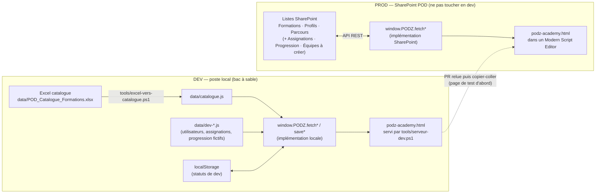

# Architecture — PODz Academy

## Les 3 briques d'un environnement consommable
Un environnement n'est utilisable que s'il réunit au même endroit :
1. un **serveur** qui affiche le HTML,
2. une **authentification** (qui est connecté),
3. un **accès live aux données**.

On ne peut pas brancher un HTML local sur les listes SharePoint de prod : le dev
recrée donc ces 3 briques **en local**, la prod les trouve **dans SharePoint**.

| Brique | Dev (bac à sable) | Prod |
|---|---|---|
| Serveur | `tools/serveur-dev.ps1` (localhost:8080) | Page SharePoint, web part Modern Script Editor |
| Authentification | Utilisateur simulé (bandeau dev « Se connecter en tant que… ») | Utilisateur SharePoint connecté (`/_api/web/currentuser`) |
| Données | `data/catalogue.js` (depuis l'Excel) + `data/dev-*.js` (fictifs) + `localStorage` pour les écritures | Listes SharePoint via API REST |

## Schéma

## Couche d'accès aux données
Le code d'affichage n'appelle que des fonctions `window.PODZ.*` (toutes renvoient une
Promise). Seule leur implémentation change entre dev et prod. Détail des signatures et
des requêtes REST visées : `PLAN.md` § 1.4.

| Fonction | Dev (implémenté) | Prod (à écrire, session 5) |
|---|---|---|
| `fetchCatalogue()` | `data/catalogue.js` → `mapItem` | GET liste Formations → `mapItem` |
| `fetchProfils()` / `fetchParcours()` | tableaux `PROFILS` / `PARCOURS` du HTML | GET listes Profils / Parcours |
| `fetchUtilisateur()` | utilisateur du bandeau dev (`podz.dev.utilisateur`, défaut Camille) | `/_api/web/currentuser` + liste Équipes |
| `fetchUtilisateurs()` / `fetchEquipe(managerId)` | `data/dev-utilisateurs.js` | GET liste Équipes |
| `fetchAssignations(userIds)` | `data/dev-assignations.js` + surcouche `podz.dev.assignations` | GET liste Assignations filtrée |
| `fetchProgression(userIds)` | `data/dev-progression.js` + surcouche `podz.dev.progression` | GET liste Progression filtrée |
| `saveStatut(consultantId, formationId, changement)` | contrôle `calc.transition` → `localStorage` | POST / MERGE Progression (`X-RequestDigest`) |
| `saveAssignation(a)` | contrôle des droits, RG9 → `localStorage` | POST / MERGE Assignations |
| `resetDev()` | efface les clés `podz.dev.*` | — |
| `sp.get / digest / creer / modifier / typeEntite` | squelettes qui **rejettent** | helpers REST à écrire |

Conversions : `PODZ.map.*` (`mapUtilisateur`, `mapAssignation`, `mapProgression`,
`toItemAssignation`, `toItemProgression`) entre le format des items REST SharePoint et les
objets d'affichage. Les calculs (avancement, niveaux, prochaine étape, transitions de
statut, droits) sont des fonctions pures `PODZ.calc.*`, testées par
`tests/tests-calculs.html`.

## Chargement des données de dev (D-P9)
Le premier `<script>` du HTML définit `PODZ_CONFIG` (`env`, noms des listes) et
`PODZ.pret`. Sur `localhost` / `127.0.0.1`, `PODZ.pret` injecte `data/catalogue.js` puis
les `data/dev-*.js` ; ailleurs, rien n'est chargé et toutes les fonctions sans
implémentation SharePoint rejettent avec « Implémentation SharePoint à écrire au passage
en prod » : la page ne peut jamais écrire en prod par accident. `?env=prod` (accepté
seulement sur localhost) simule ce mode. Le HTML ne contient aucune balise
`<script src="data/…">`.

## Décisions prises
- **D1 — Dev 100 % local**, données issues de l'Excel : aucune connexion à SharePoint
  en dev, donc aucun risque pour la prod.
- **D2 — Format SharePoint conservé** dans les données de dev (`mapItem` identique).
- **D3 — Fichier HTML unique**, JS vanilla, pas de dépendance externe (contrainte
  Modern Script Editor).
- **D4 — Outillage PowerShell** (pas de Node/Python sur les postes POD).
- **D5 — Écritures de dev dans `localStorage`** : propre à chaque navigateur, suffisant
  pour tester le suivi des statuts sans base de données.
- **D6 — Parcours types provisoirement déduits de l'offre** (l'Excel n'a pas de colonne
  Parcours) ; les parcours suivis sont désormais de vraies assignations (copies).
- **D-P1 à D-P10** (session 3) : voir `PLAN.md` § 0 — ordre global des modules (PO11),
  ↑ / ↓, réactivation d'un parcours archivé, « Mes formations », colonne `Techno` en
  attente du métier, certification au choix, démarrage au clic depuis tout écran,
  chargement dev réservé à localhost, tests des calculs.
- Écarts faits pendant l'exécution (session 4) : `PLAN.md` § 6.

## Déploiement (cible)
1. Propriétaire du site : création des listes Assignations, Progression, Équipes et de la
   colonne `Techno`, permissions (`PLAN.md` § 4).
2. Session 5 : implémentation SharePoint de la couche de données (`SESSION-5-PROD.md`).
3. Test sur une **page SharePoint de test**.
4. PR de la branche vers `main`, relue.
5. Copier-coller dans la page de prod par l'utilisateur.

## Points ouverts
- PO9 : qui crée les listes et la colonne `Techno` en prod, et leurs noms / URL exacts.
- PO12 : remplissage de la colonne `Techno` dans l'Excel par le métier.
- Dépôt GitHub public ou privé : conditionne ce qu'on peut pousser (liens internes,
  prénoms présents dans l'Excel).
- Le rendu peut différer entre localhost et SharePoint (thème, largeur) : toujours
  valider sur la page de test.
