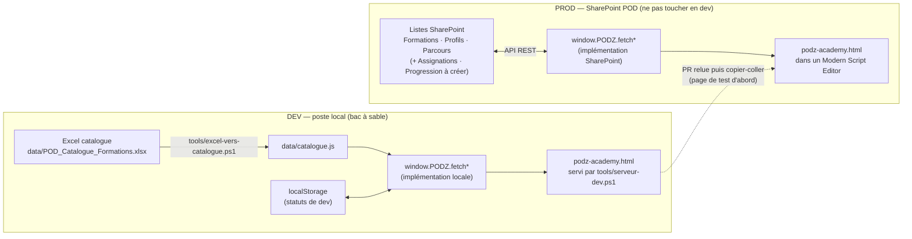

# Architecture — PODz Academy

## Les 3 briques d'un environnement consommable
Un environnement n'est utilisable que s'il réunit au même endroit :
1. un **serveur** qui affiche le HTML,
2. une **authentification** (qui est connecté),
3. un **accès live aux données**.

On ne peut pas brancher un HTML local sur les listes SharePoint de prod : le dev
recrée donc ces 3 briques **en local**, la prod les trouve **dans SharePoint**.

| Brique | Dev (bac à sable) | Prod |
|---|---|---|
| Serveur | `tools/serveur-dev.ps1` (localhost:8080) | Page SharePoint, web part Modern Script Editor |
| Authentification | Utilisateur simulé (sélecteur « Se connecter en tant que… ») — *à construire* | Utilisateur SharePoint connecté (`/_api/web/currentuser`) |
| Données | `data/catalogue.js` (depuis l'Excel) + `localStorage` pour les écritures | Listes SharePoint via API REST |

## Schéma

## Couche d'accès aux données
Le code d'affichage n'appelle que des fonctions `window.PODZ.*`. Seule leur
implémentation change entre dev et prod.

| Fonction | Existe | Dev | Prod |
|---|---|---|---|
| `fetchCatalogue()` | ✅ | `window.PODZ_CATALOGUE` → `mapItem` | GET liste formations → `mapItem` |
| `fetchProfils()` | ✅ | tableau `PROFILS` dans le HTML | GET liste Profils |
| `fetchParcours()` | ✅ | tableau `PARCOURS` dans le HTML | GET liste Parcours |
| `fetchUtilisateur()` | à créer | utilisateur choisi dans le sélecteur | `/_api/web/currentuser` |
| `fetchAssignations(user)` | à créer | fichier de données de dev | GET liste Assignations filtrée |
| `fetchProgression(user)` | à créer | `localStorage` | GET liste Progression filtrée |
| `saveStatut(user, formation, statut)` | à créer | `localStorage` | POST/MERGE liste Progression (`X-RequestDigest`) |

Les définitions exactes (champs, statuts) seront fixées en session Specs.

## Décisions prises
- **D1 — Dev 100 % local**, données issues de l'Excel : aucune connexion à SharePoint
  en dev, donc aucun risque pour la prod.
- **D2 — Format SharePoint conservé** dans les données de dev (`mapItem` identique).
- **D3 — Fichier HTML unique**, JS vanilla, pas de dépendance externe (contrainte
  Modern Script Editor).
- **D4 — Outillage PowerShell** (pas de Node/Python sur les postes POD).
- **D5 — Écritures de dev dans `localStorage`** : propre à chaque navigateur, suffisant
  pour tester le suivi des statuts sans base de données.
- **D6 — Parcours provisoirement déduits de l'offre** (l'Excel n'a pas de colonne
  Parcours) ; remplacés par les vraies assignations en session Specs/Exécution.

## Déploiement (cible)
1. PR de la branche vers `main`, relue.
2. Création par un **propriétaire du site** des nouvelles listes (Assignations,
   Progression) et des permissions (chacun ne modifie que sa propre progression).
3. Passage de la couche de données en implémentation SharePoint.
4. Test sur une **page SharePoint de test**, puis copier-coller dans la page de prod.

## Points ouverts
- Qui peut créer les listes Assignations / Progression côté SharePoint (pas d'admin) ?
- Noms et URL exacts des listes SharePoint de prod (à récupérer, lecture seule).
- Visibilité : un consultant voit-il les parcours des autres ? un manager voit-il son
  équipe ?
- Dépôt GitHub public ou privé : conditionne ce qu'on peut pousser (liens internes,
  prénoms présents dans l'Excel).
- Le rendu peut différer entre localhost et SharePoint (thème, largeur) : toujours
  valider sur la page de test.
